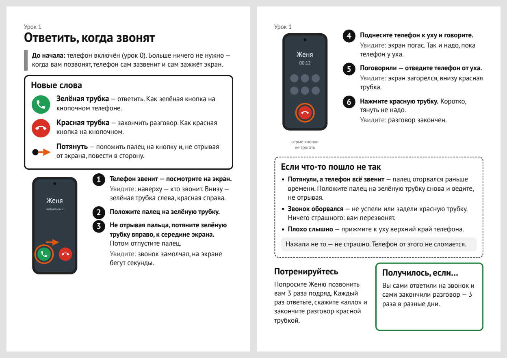
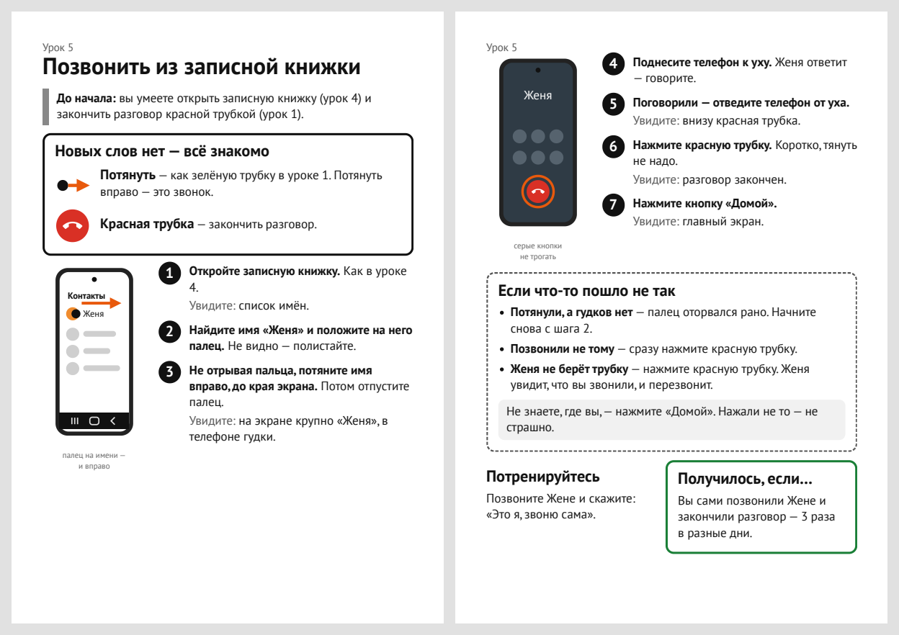

# Уроки смартфона для пожилых

Бумажные уроки для человека, который ни разу не пользовался смартфоном. Каждый урок —
одно умение на двух листах А4: распечатать и отдать. Сделаны для Samsung Galaxy A37 5G.

## Как выглядит урок

**Урок 1. Ответить, когда звонят**



**Урок 5. Позвонить из записной книжки**



## Уроки (PDF для печати)

Все уроки одним файлом: [all_lessons.pdf](lessons/all_lessons.pdf) — содержание и уроки 0–7.

| № | Урок | PDF |
|---|---|---|
| — | Содержание с галочками «Получилось» | [pdf](lessons/contents/lesson.pdf) |
| 0 | Включить и выключить телефон | [pdf](lessons/00_power/lesson.pdf) |
| 1 | Ответить, когда звонят | [pdf](lessons/01_answer_call/lesson.pdf) |
| 2 | Сделать звонок громче или тише | [pdf](lessons/02_ring_volume/lesson.pdf) |
| 3 | Разбудить телефон и вернуться кнопкой «Домой» | [pdf](lessons/03_wake/lesson.pdf) |
| 4 | Открыть записную книжку | [pdf](lessons/04_contacts/lesson.pdf) |
| 5 | Позвонить из записной книжки | [pdf](lessons/05_call_contact/lesson.pdf) |
| 6 | Кто звонил, пока вас не было | [pdf](lessons/06_missed_call/lesson.pdf) |
| 7 | Набрать номер | [pdf](lessons/07_dial_number/lesson.pdf) |

Перед печатью урока 7 впишите от руки номер для тренировки.
Перед первым уроком настройте телефон: [setup/phone_setup.md](setup/phone_setup.md).

## Правила создания уроков

- [Правила урока](rules/lesson_rules.md) — как устроен один лист.
- [Правила курса](rules/course_rules.md) — порядок уроков и сколько нового за раз.
- [Запрещённые слова](rules/forbidden_words.md) — и чем их заменить.
- [Источники](rules/sources.md) — исследования, на которые опираются правила.
- [Карта навыков](course/skill_map.md) — что учим, в каком порядке, словарь курса.

У каждого урока есть `notes.md` для того, кто учит: что сверить на телефоне, что пока
гипотеза.

## Собрать PDF

```
uv run scripts/build_lessons.py
```

Нужен Google Chrome. Исходники уроков — `lessons/*/lesson.html`.
